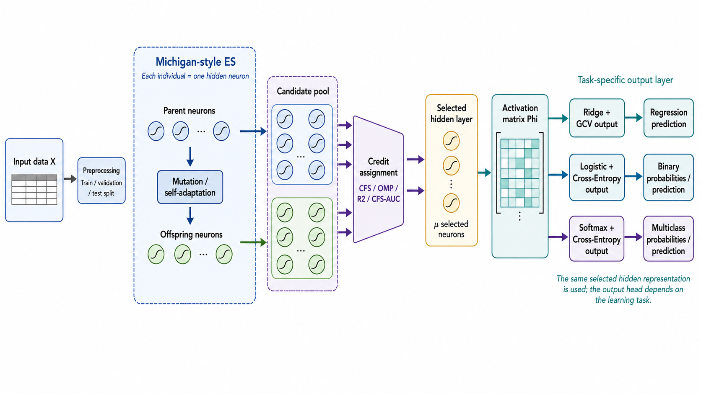
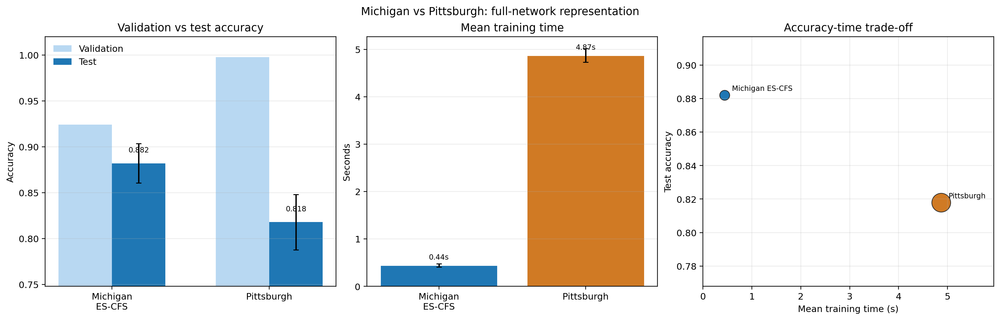

# Training Neural Networks with Evolution Strategies

**Bachelor's thesis, Artificial Intelligence — Universitat Politècnica de Catalunya (UPC).**
Pau Prat Moreno · supervisor: Luis Antonio Belanche Muñoz

Instead of evolving *complete* neural networks, this prototype evolves **one hidden neuron per individual**. The surviving population becomes the hidden layer of a compact MLP. The output layer is then fitted to the task: logistic or softmax for classification, Ridge + GCV for regression.

[Thesis PDF](TFG_Pau_Prat_Moreno.pdf) · [Defence slides](https://paupratAI.github.io/TFG/) · [Source](#repository-map) · [Contact](#author)

<p align="center">
  
</p>

<p align="center"><em>One individual = one tanh neuron. Credit assignment selects the hidden layer. The output head depends on the task.</em></p>

## Why this is interesting

Neuroevolution usually treats each individual as a full network (Pittsburgh). That makes fitness easy and the search space huge. Here each individual is a single hidden neuron (Michigan). The hard problem is **credit assignment**: which neurons deserve to survive when they only make sense as a set.

The thesis does **not** claim to beat every tabular model. It shows that neuron-level evolution can build a useful hidden representation, generalise better than full-network evolution in the tested setting, and do so at much lower cost.

## Headline results

All figures below are from the thesis evaluation (same splits, validation-controlled model selection, test set untouched until the end).

| Finding | Evidence |
| --- | --- |
| **Michigan beats full-network Pittsburgh** | Test accuracy **88.2% vs 81.8%**, ROC-AUC **0.935 vs 0.864**, validation–test gap **0.042 vs 0.180** |
| **About 11× cheaper to train** | Mean fit time **0.44 s vs 4.87 s** (250 candidate neurons + 1 output fit vs 400 complete networks / generation) |
| **Evolved features add value** | ES-CFS logistic **88.1%** test acc vs linear logistic **87.6%**, random tanh **85.7%**, gradient MLP **85.9%** |
| **Credit assignment matters** | CFS is the strongest of four neuron-selection rules (OMP, *R*², CFS, CFS-AUC) on the binary logistic benchmark |
| **The hidden layer can be compressed** | L1-logistic keeps **~18 of 50** neurons and **89.6%** test accuracy |

Honest caveat: on the same binary datasets, **RBF SVM (91.8%)** and **Random Forest (91.1%)** still win mean test accuracy. The contribution is the representation and the Michigan vs Pittsburgh trade-off, not a new state of the art on tabular data.

<p align="center">
  
</p>

## Quick start

```bash
python -m pip install -r requirements.txt
python train.py --strategy cfs --data-id 59 --epochs 100 --save-dir runs
```

`59` is OpenML Ionosphere. The default loop mutates a Michigan population, selects hidden neurons, and fits the output layer. With a validation split, the checkpoint with highest validation accuracy is kept; test metrics are computed only after that choice.

## How it works

1. `data.py` loads a numeric OpenML (or sklearn) dataset, splits **before** preprocessing, imputes and standardises on the training split only.
2. `core_es.py` maintains a Michigan population: each individual is one tanh neuron with a self-adaptive mutation matrix.
3. `selection.py` scores candidate neurons with `omp`, `r2`, `cfs`, or `cfs_auc`.
4. The selected population is the hidden layer. Activations form the matrix Φ.
5. The output head is task-specific:
   - **Regression:** Ridge + GCV (`gcv.py`)
   - **Binary:** unregularised logistic + cross-entropy (`logistic_output.py`)
   - **Multiclass:** softmax + cross-entropy

## Experiments

| Script | What it answers |
| --- | --- |
| `compare_strategies.py` | Which neuron-selection rule should be the default? |
| `ridge_defense_suite.py` | Does ES-CFS logistic beat linear / random-feature / MLP / classical tabular baselines? |
| `ridge_regression_benchmark.py` | Does the same hidden representation help Ridge/GCV regression? |
| `lasso_filter_benchmark.py` | Can a second L1 filter sparsify the evolved layer? |
| `logistic_multiclass_benchmark.py` | Does the idea transfer to softmax multiclass? |
| `benchmark_full_network_pittsburgh.py` | Michigan neuron vs Pittsburgh full network, including a matched-budget control |
| `analyze_michigan_pittsburgh_wilcoxon.py` | Paired significance tests on that comparison |

Minimal binary comparison (Ionosphere, Sonar, Breast-W; three seeds):

```bash
python compare_strategies.py \
  --datasets ionosphere sonar breast-w \
  --seeds 42 43 44 \
  --epochs 60 --mu 50 --offspring 250 \
  --validation-size 0.2 \
  --output-dir runs/strategy_comparison
```

Figures used in the report are in [`plots_overleaf/`](plots_overleaf/). Regenerating them:

```bash
python make_final_plots.py
```

## Repository map

```
train.py                         training loop
core_es.py / selection.py / gcv.py / logistic_output.py
data.py                          loading and leak-free preprocessing
TFG_Pau_Prat_Moreno.pdf          compiled thesis
docs/                            defence slides (GitHub Pages)
overleaf/                        LaTeX chapter sources
plots_overleaf/                  report figures
generate_slides.js               rebuilds docs/index.html
```

Open the slides locally with `open docs/index.html` (or any browser). Speaker notes: [`docs/speaker-notes.txt`](docs/speaker-notes.txt).

## Author

**Pau Prat Moreno** — BSc Artificial Intelligence, UPC BarcelonaTech.

GitHub: [paupratAI](https://github.com/paupratAI)

If you work on neuroevolution, tabular models, or evolutionary credit assignment, I would like to hear from you.
